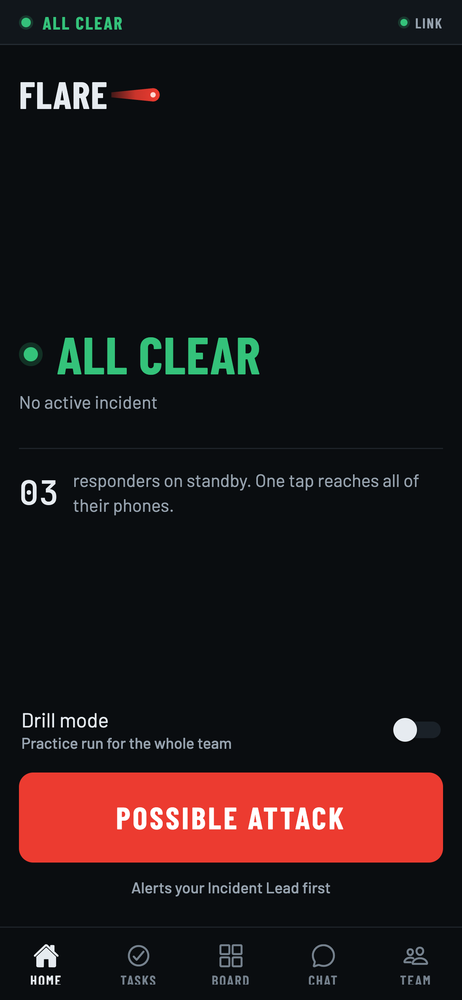
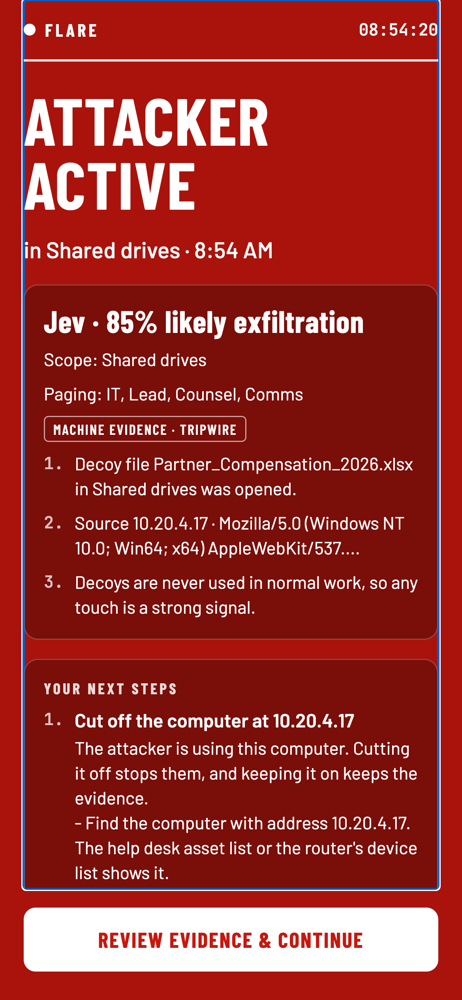
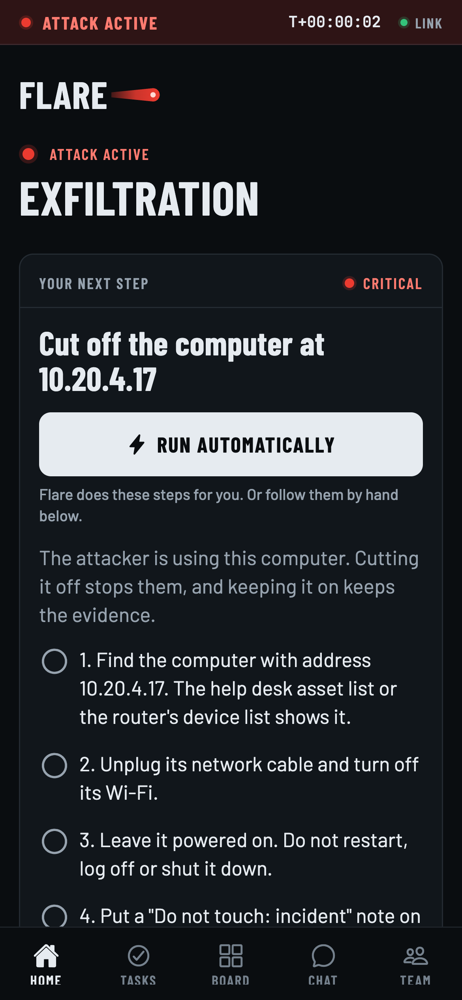
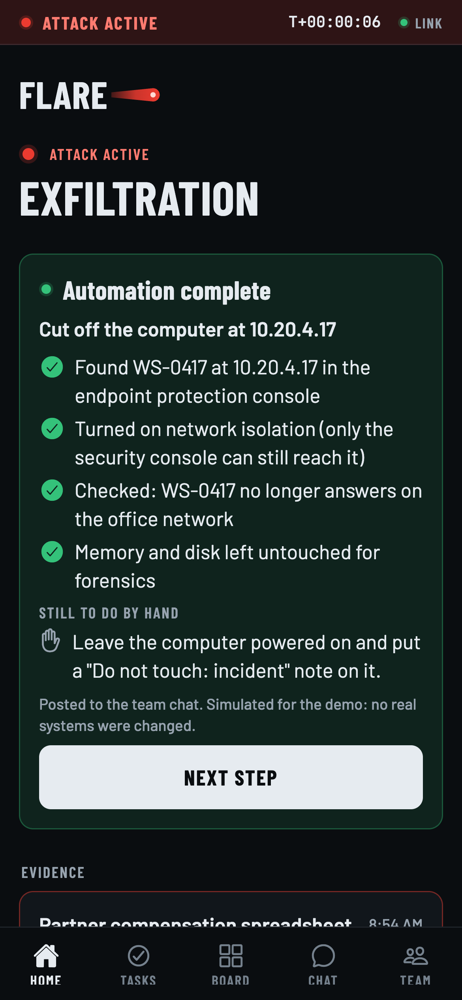
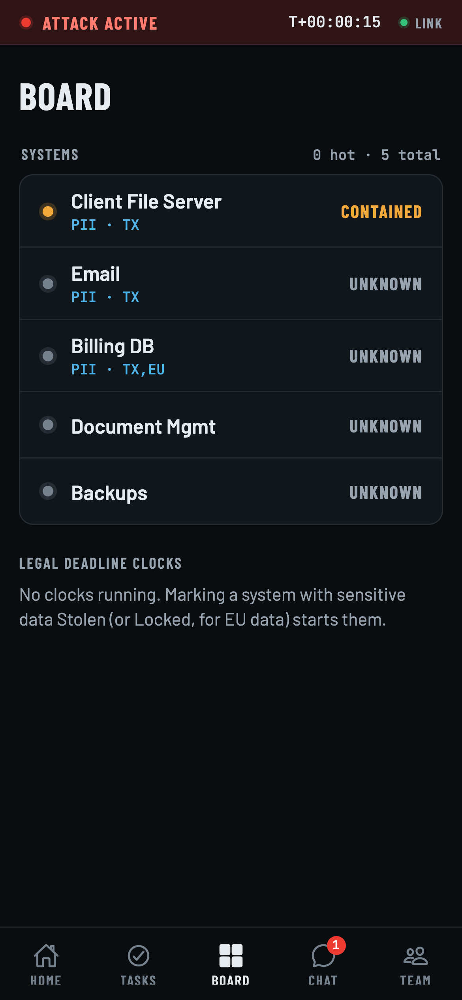
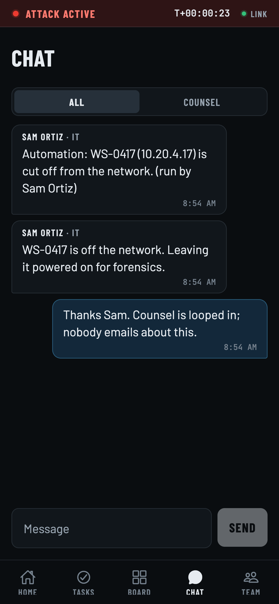
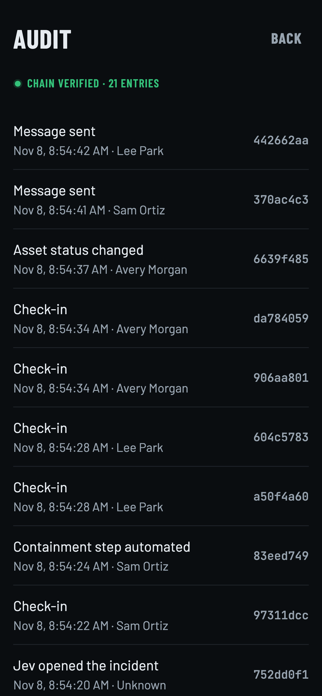
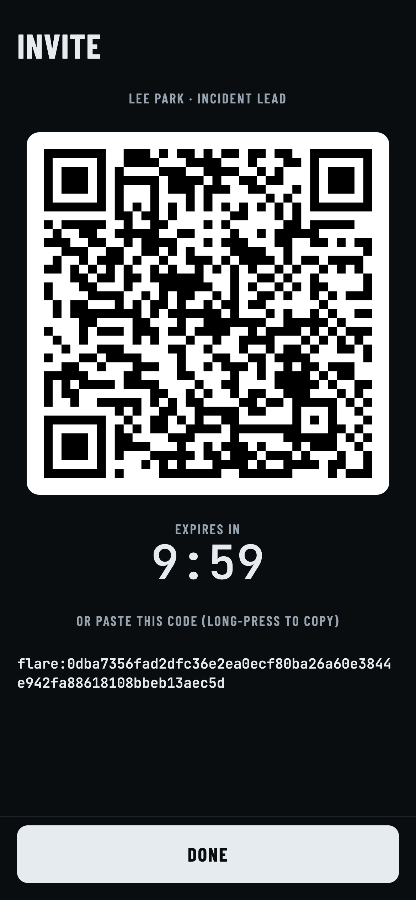

<p align="center">
  
</p>

<p align="center">
  <strong>When attackers own your network, Flare is the command center they can't touch.</strong>
</p>

<p align="center">
  HackUTD 2026 · Winstead PC Cyber Incident Response Challenge · Built on SpacetimeDB
</p>

---

## What it is

Flare is an out-of-band command center for cyber incident response. It runs on responders' **personal
phones** over cellular data and is hosted on **SpacetimeDB Maincloud**, completely outside the company
network. The attacker is assumed to control every internal system: email, SSO, chat, laptops, Wi-Fi.
None of them are needed for Flare to work.

When an attack is detected, every enrolled responder is alerted, sees the next pre-approved step for
their role, and coordinates in a private group chat. Every action lands in a tamper-evident,
hash-chained timeline.

## How it meets the challenge

| Winstead requirement | How Flare covers it |
|---|---|
| **01 Secure and isolated** | Personal phones, cellular data, hosted off the company network. No company email, SSO, devices or Wi-Fi in the path. TLS-only connections (`wss://`). |
| **02 Access control** | Admins add people with one-time, in-person QR invites. Invites only flow downward (Admin → Lead → Members; Counsel → Guests). Each phone enrolls with its own Ed25519 device key. |
| **03 Incident documentation** | Incident lifecycle (Possible → Active → Contained → Recovered), live status, task progress and chat, all recorded in a SHA-256 hash-chained audit log that can be verified on the phone. |
| **04 Scope definitions** | The Board tracks every data system as Unknown, Attacker active, Locked (ransomware), Stolen (exfiltrated), Contained, Restored or Safe. Marking PII as Stolen or Locked starts legal notice clocks (Texas AG, GDPR 72 hours). |
| **05 Real-time communications** | Team chat plus a privileged Counsel channel, synced live to every phone by SpacetimeDB. |

| Judging criterion | Our answer |
|---|---|
| **Security** | Nothing internal can command Flare. Company credentials are useless here. Base tables are private and exposed only through member-scoped views. |
| **Ease of use** | Works like a group text. Each person sees one card: **Your next step**, with a one-tap **Run automatically** button and plain-language steps below it. No tutorial needed. |
| **Creativity** | Tripwire decoys, Jev deterministic triage, one-tap containment, legal deadline clocks, hash-chained evidence log. |

## Features

- **Tripwires.** IT plants decoy files, a fake login and fake API keys on the intranet. When an
  attacker touches one, a relay reports the hit to Flare and phones show "Attacker active".
- **Jev triage.** A deterministic scoring engine (`server/src/jev.ts`), not a language model. The same
  evidence always gives the same result: probability, tier, incident type (exfiltration, credential
  theft, ransomware), affected systems and cited evidence. High-tier hits open the incident, mid-tier
  hits wait for a Lead, low-tier hits are only logged.
- **Alerting with a two-person rule.** Any member can raise a possible attack. It becomes active when a
  *different* Lead or Admin confirms it, or when two members report it independently.
- **Role-based next steps.** Tasks are generated per role (IT, Lead, Counsel, Comms, Executive,
  Finance, HR) from the attack type and evidence, filled in with the real IP, file, system and time.
- **Run automatically.** One tap carries out an IT containment step (isolate host, lock account,
  revoke keys, block egress, export logs), posts the result to chat and updates the Board. In this demo
  the actions are **emulated** and the result card says so. Each step maps one-to-one to a real API call
  on a cloud-hosted control plane (EDR, identity provider, cloud firewall, SIEM). See `NOTES.md`.
- **Board and legal clocks.** Data systems with live status, plus countdowns for notice obligations,
  labeled "possible obligation, confirm with counsel".
- **Chat.** Team channel and a Counsel-only channel for privileged discussion.
- **Audit.** Every action is appended to a hash chain. The Audit screen re-verifies the whole chain.

## Screenshots

| Home, all clear | Jev alarm | IT next step | Automation done |
|---|---|---|---|
|  |  |  |  |

| Board | Chat | Audit | Invite |
|---|---|---|---|
|  |  |  |  |

## Security model

| Layer | Mechanism |
|---|---|
| Transport | TLS only; the app refuses any non-`wss://` host |
| Isolation | Phones on cellular data to SpacetimeDB Maincloud; no company system in the path |
| Enrollment | Invite secret is 32 random bytes from the phone's CSPRNG; the server stores only its SHA-256 hash. Redemption is atomic and single-use. |
| Device identity | Ed25519 key pair per phone (`@noble/curves`); the join request is signed and verified on the server |
| Verification | Key fingerprints (first 16 hex of SHA-256 of the public key) compared in person |
| PIN | PBKDF2-SHA256 with a random 16-byte salt, stored in iOS Keychain / Android Keystore via `expo-secure-store` |
| Authorization | Reducers check membership on the server, and role where an action is restricted (confirming alerts, Counsel channel, invites); sensitive tables are private and read through member-scoped views |
| Evidence | SHA-256 hash-chained audit log: `sha256(seq | time | actor | action | dataHash | prevHash)`. Any edit or deletion breaks the chain. |
| Alerts | Full-screen in-app alarm driven by the live SpacetimeDB subscription; no incident details are sent to any third-party push service |

**Roadmap:** content-free background push, end-to-end encrypted chat with a group key exchanged at enrollment, per-message device
signatures, message bodies hashed into the audit chain, higher PBKDF2 iteration count, and real
containment integrations behind least-privilege API keys.

## Architecture

```
 Responder phones (Expo / React Native)          Tripwire relay (Node)
        │  wss:// over cellular                        │  HTTPS reducer calls
        └──────────────────┬───────────────────────────┘
                           ▼
              SpacetimeDB Maincloud (TypeScript module)
        tables · reducers · member-scoped views · audit chain
```

- **`app/`** Expo SDK 58 app (expo-router, SpacetimeDB React hooks)
- **`server/`** SpacetimeDB TypeScript module: enrollment, incidents, Jev, tasks, automation, board, chat, audit
- **`shared/`** types and crypto used by both sides (roles, audit hashing, Ed25519 helpers)
- **`tripwire-demo/`** fake intranet with decoys plus the relay that reports hits
- **`scripts/`** publish, smoke and end-to-end demo scripts

**Stack:** SpacetimeDB 2.14, Expo 58, React Native 0.88, React 19, TypeScript 5.9, `@noble/curves`,
`@noble/hashes`.

## Run it

Requires Node >= 24.22.1 and the `spacetime` CLI 2.14.

```sh
npm install
npm test            # shared + server unit tests
npm run typecheck
npm run start       # Expo dev server (scan with Expo Go)
npm run web         # web build, includes the tabletop demo at /demo.html
```

Tripwire demo:

```sh
cd tripwire-demo && node relay.mjs
```

Publishing uses the isolated scripts (`npm run publish:dev`, `npm run publish:demo`). Put the Spacetime
token in a gitignored `.env` (see `.env.example`). Never commit it.

## More

- [`winstead-rules.md`](winstead-rules.md) – the challenge brief
- [`NOTES.md`](NOTES.md) – how Run automatically and Jev work
- [`plan.md`](plan.md) – original design plan
