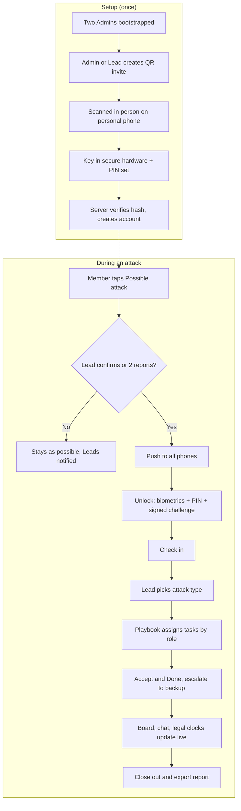

# Red Phone: Out-of-Band Cyber Incident Response

Winstead PC Hackathon Challenge · Built on SpacetimeDB · HackUTD 2026

## Overview

Red Phone is a sealed emergency channel that runs entirely outside the company. It lives on employees' personal phones, uses cellular data only, and is hosted on SpacetimeDB Maincloud. When a cyber attack happens, it gives every responder a secure place to talk and a clear list of next steps for their role.

**Core idea:** the attacker is assumed to control every internal system, so the response can't depend on any of them. People are stressed, so the app has to work like a group text with big buttons and tell each person what to do next.

### How it maps to the challenge

| Required component | How Red Phone covers it |
|---|---|
| 01 Secure and isolated | Personal phones, cellular only, hosted off the company network. No company email, SSO, devices or Wi-Fi. |
| 02 Access control | One-time, in-person QR invites issued by a higher authority. Roles and authority levels. |
| 03 Incident documentation | Every tap and message becomes a timestamped, tamper-evident timeline and an exportable report. |
| 04 Scope definitions | Status board tracks each data system: Unknown, Locked, Stolen, Contained, Restored, Safe. |
| 05 Real-time communications | Group chat, push-to-talk, and a counsel-only channel, synced live by Spacetime. |

### Judging criteria

- **Security:** company credentials are useless here. Access uses a key in the phone's secure hardware plus biometrics and a personal PIN. Even full control of internal systems gives the attacker no way in.
- **Ease of use:** looks and works like a group text. The app pushes each person's next step, like a pilot's emergency checklist, so nothing has to be remembered under stress.
- **Creativity:** role-based playbooks assign tasks automatically, legal deadline clocks start from what responders report, the audit log is hash-chained for evidence, and a duress PIN silently alerts admins.

---

## 1. Enrollment: invite-only, in person

### Root of trust
- At deployment, a one-time setup code creates the first **two Admins** (for example, the managing partner and the general counsel).
- Promoting anyone to Admin requires **two Admins to approve**, so no single compromised person can take over.

### Invite rules
- Invites only flow downward. Admins can invite Leads and Members. Leads can invite Members and Guests. Nobody can create an account at or above their own level.
- No email, text or company system is ever used to send an invite.

### Creating an invite
1. The inviter picks a role and a display name for the new person.
2. The app shows a QR code on the inviter's screen. It expires in **10 minutes**.
3. The QR code holds a random 256-bit secret. The server stores only a **hash** of the secret, never the secret itself.

### Redeeming an invite
1. The new person scans the QR code face to face with the app on their **personal phone**. Company-managed phones are not allowed, since the attacker may control the company's device management.
2. The phone generates a private key inside its secure hardware (Secure Enclave on iPhone, Keystore on Android). The key never leaves the phone.
3. The person sets a **personal PIN** and an optional **duress PIN**.
4. The server checks the secret's hash and expiry, marks the invite used, and creates the account (name, role, public key, inviter) in **one atomic transaction**. A second scan of the same code fails.

---

## 2. Unlocking during an alert

1. A push notification arrives with no details: "Red Phone: open app." Apple and Google route the push, so it reveals nothing to them or to anyone watching.
2. The person unlocks with **Face ID or fingerprint plus their PIN**. Both checks happen on the phone; the PIN never travels anywhere.
3. The phone **signs a one-time challenge** from the server with its private key. A stolen session token alone gets an attacker nothing.
4. The **duress PIN** opens a harmless decoy screen and silently alerts the Admins.

---

## 3. Traceability

Accounts are traceable through hashes in three ways. Names are not hashed, since names are easy to guess and the hash could be reversed.

- **Key fingerprint:** a short hash of each account's public key. Members can compare fingerprints in person, like Signal's safety numbers.
- **Invite lineage:** every account records who invited it. If a bad account appears, trace it to its inviter and revoke that whole branch in one action.
- **Hash-chained audit log:** every action stores who did it, when, and the hash of the previous entry. Any edit or deletion breaks the chain visibly, giving tamper-evident evidence for lawyers and insurers.

---

## 4. Attack response flow

1. **Raise alert.** Any member taps "Possible attack." It becomes a full alert when one Lead confirms it or two members report independently. This prevents false panic from one person or one stolen phone.
2. **Push to everyone** enrolled.
3. **Unlock** with biometrics, PIN, and signed challenge (section 2).
4. **Check in.** Each person taps "I'm here," "Unavailable," or "My work device may be affected." The Lead sees who is present.
5. **Pick the attack type.** The Lead chooses Ransomware, Account takeover / phishing, Data theft, Wire fraud, or Unknown. This loads the matching playbook.
6. **Tasks arrive by role.** Each person accepts tasks and taps "Done." Dependent tasks stay locked until earlier ones finish. A task not accepted within a few minutes goes to the backup person and alerts the Lead.
7. **Live coordination.** Status board, group chat, counsel-only channel, and legal deadline clocks run throughout.
8. **Close out.** Incident moves Contained → Recovered → Closed. Export the report. Guest accounts expire automatically.

### How tasks are assigned automatically
- **Before any incident:** the firm and its counsel write playbooks. Each is a list of tasks tagged with a trigger and a role (for example, "Data locked → IT: unplug affected machines").
- **On a status tap or attack type selection:** a reducer records the change and looks up every playbook step with that trigger.
- **Assignment:** each task goes to whoever holds that role. Spacetime instantly pushes it to that person's phone.
- **Follow-through:** dependencies unlock in order; a scheduled reducer reassigns unaccepted tasks to the backup and alerts the Lead.

The app never decides what to do. It delivers the firm's own pre-approved plan to the right person at the right moment.

### Example: ransomware ("Data locked")
- **IT:** unplug affected machines from the network but don't power them off (memory holds evidence). Check that backups are intact and offline. Find the first infected machine.
- **Incident Lead:** call the cyber insurance hotline first (insurers often require their approved firms). Assign owners to each task.
- **Counsel:** engage outside forensics through counsel to protect privilege. Review which notification deadlines apply.
- **Comms:** tell staff through Red Phone, not company email. Prepare a holding statement.
- **Executive:** don't contact the attacker or pay anything until counsel and the insurer weigh in; paying certain groups can violate sanctions law.

### Legal deadline clocks
When responders report facts (for example, "Client PII stolen, Texas residents"), matching rules start countdowns for Counsel and the Lead. Examples:

| Clock | Starts when | Deadline |
|---|---|---|
| Texas Attorney General | Breach determined, 250+ Texas residents | 30 days |
| Texas individuals | Breach discovered | 60 days |
| SEC 8-K Item 1.05 (public companies) | Materiality determination | 4 business days |
| GDPR (EU personal data) | Awareness of breach | 72 hours |
| CIRCIA (critical infrastructure, pending) | Reasonable belief / ransom payment | 72 hours / 24 hours |

Clocks are labeled "possible obligation, confirm with counsel." Rules are configurable. Each clock links to the timeline event that started it.

---

## 5. Roles

| Role | Responsibility | Can invite |
|---|---|---|
| Admin | Enrollment authority, revoking access, lockdown | Leads, Members |
| Incident Lead | Confirms alert, picks playbook, assigns tasks | Members, Guests |
| IT / Security | Isolate machines, check backups, preserve evidence | — |
| Counsel | Privilege, notification deadlines, outside firms | Guests |
| Comms | Staff and client messaging, press statement | — |
| Executive | Final decisions: ransom, shutdown, disclosure | — |
| Finance | Insurance claims, verifying payment requests | — |
| HR | Employee issues, insider-threat cases | — |
| Guest (outside forensics, outside counsel, insurer) | Limited view, auto-expires | — |
| Observer | Read-only | — |

Every role has a named **backup person**.

---

## 6. Data schema (SpacetimeDB tables)

| Table | Key fields | Visible to |
|---|---|---|
| `member` | id, display_name, role, level, status (active / suspended / revoked), invited_by, key_fingerprint, backup_for | All members (names and roles only) |
| `invite` | id, secret_hash, role, level, created_by, expires_at, used_by | Inviter and Admins |
| `challenge` | member_id, nonce, expires_at | That member only |
| `incident` | id, type, status, raised_by, confirmed_by, timestamps | Members |
| `checkin` | incident_id, member_id, state, time | Members |
| `playbook` / `playbook_step` | attack_type, order, role, task, depends_on, escalate_after | Members (written in advance) |
| `task` | incident_id, step_id, assigned_to, status, times | Members |
| `asset` / `asset_status` | system name, contains PII (which states), status, set_by | Members |
| `message` | incident_id, channel (all / counsel / role), author, body, time | Filtered by channel |
| `clock_rule` / `clock` | trigger, deadline, recipient, status | Counsel and Lead |
| `audit_log` | sequence, actor, action, data_hash, prev_hash, hash | Admins |
| `escalation_schedule` | task_id, scheduled_at (scheduled table) | Server only |

### Reducers (server functions)
- **Enrollment:** `create_invite`, `redeem_invite`, `revoke_member`, `approve_admin`, `lockdown`
- **Response:** `raise_alert`, `confirm_alert`, `check_in`, `set_attack_type`, `accept_task`, `complete_task`, `set_asset_status`, `send_message`, `mark_clock_filed`, `close_incident`
- **Scheduled:** `escalate_task`, `clock_reminder`

Every reducer verifies three things: the account is active, the role is allowed, and for sensitive actions the challenge was signed. Every reducer appends to `audit_log`.

---

## 7. Security rules

- **Separate from the business:** personal phones only, cellular only, hosted on Maincloud. No company email, sign-in, devices or Wi-Fi.
- **Content-free push notifications:** pushes carry no incident details.
- **Lockdown switch:** an Admin can freeze all non-Admin actions instantly if an account seems compromised.
- **Row-level security:** each table only reaches the roles listed above; the counsel channel is invisible to other roles.
- **Spacetime configuration:** use version 2.11 or later (fixes an identity-impersonation flaw). Scheduled reducers reject any caller except the module itself.
- **No AI decision-making:** all decisions stay with people. Playbooks are pre-written and pre-approved.

---

## 8. Build plan (by Sunday)

**Stack:** Expo (React Native) client · SpacetimeDB module (TypeScript or Rust) · Maincloud hosting (HACKUTD2026 credit) · `expo-secure-store` for keys · `expo-local-authentication` for biometrics · Expo push for notifications.

### Must-haves
- [ ] Bootstrap two Admins
- [ ] QR invite create and redeem (hashed secret, 10-minute expiry, single use)
- [ ] Device key + PIN unlock + signed challenge
- [ ] Raise and confirm alert, push to all
- [ ] Check-in
- [ ] Ransomware playbook with role tasks, accept and done
- [ ] Status board
- [ ] Group chat + counsel channel
- [ ] Hash-chained audit log

### Stretch
- [ ] Task escalation to backups
- [ ] Legal deadline clocks
- [ ] Duress PIN
- [ ] Report export
- [ ] Additional playbooks (account takeover, wire fraud)

### Demo
A 3-minute ransomware tabletop. Judges are enrolled by scanning a QR code, receive the alert on their own phones, get role tasks, and watch the status board and clocks update live.

---

## 9. Application flow

